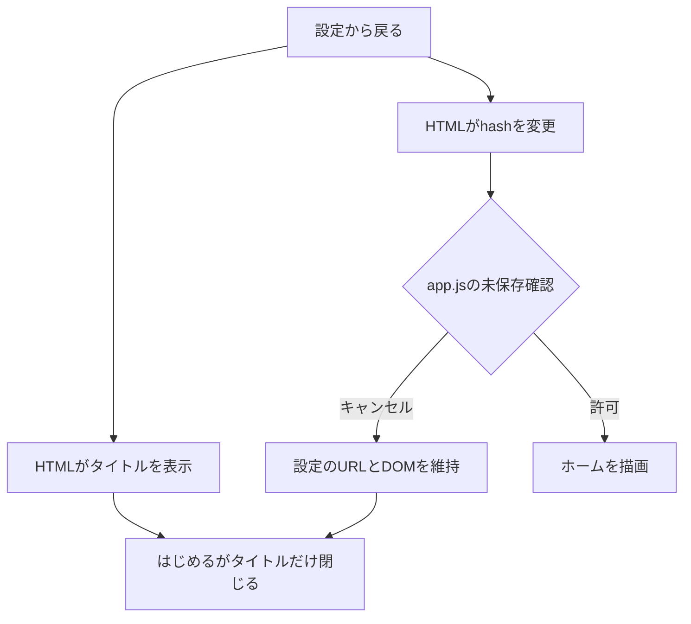
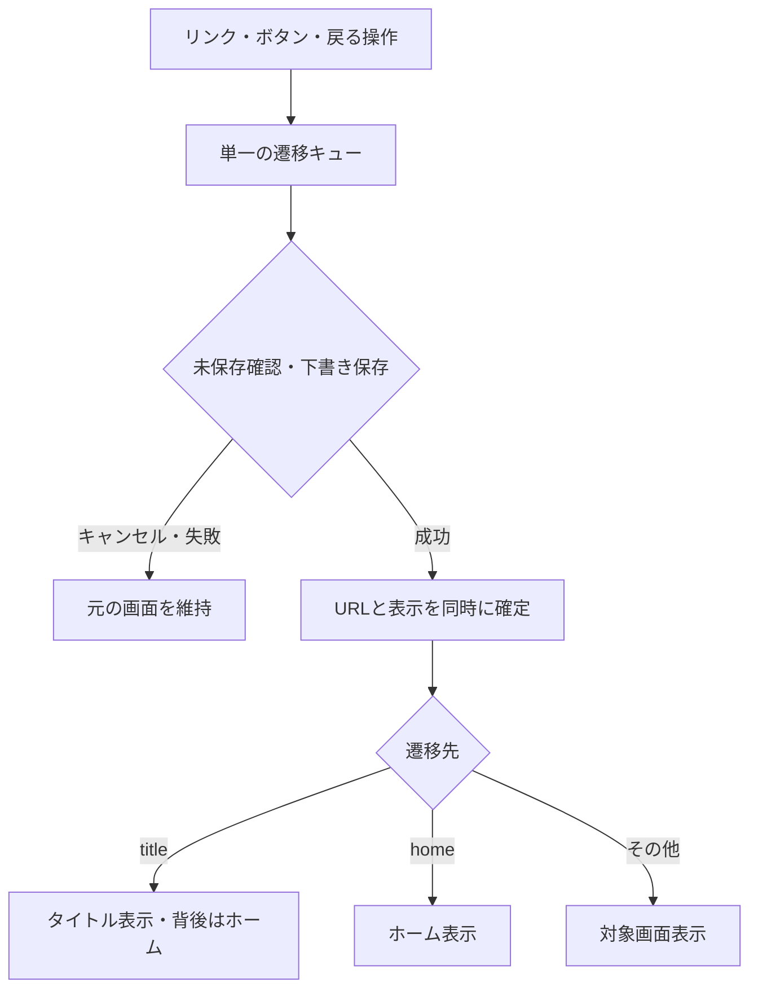

# 2.5.25 画面遷移・更新処理の見直し

調査元: main 69b1f430e25aad9ec2d2fbf04f912bd2cb8dc529（PR #77）

## 再現結果と原因

Chromium実ブラウザで旧mainを実行。通常の「設定→タイトル→はじめる」は3回ともホームへ移動した。一方、設定のチェックボックスを変更し、タイトルへ戻る際の未保存確認をキャンセルすると、設定を残したままタイトルが表示された。はじめる後は `#settings` / 設定フォームが残った。ユーザーの実機における全発生条件と同一とは断定していない。

旧構造ではHTMLの独立したタイトル処理がhashchangeの確認結果を待たずに表示を変更していた。PR #76以前のreplaceStateは描画を起動しないため、さらに同一hashでの表示不一致が起き得た。旧テストはHTML断片しか実行せず、実際のルーター・未保存確認と結合されていなかった。

追加所見: controllerchangeがHTMLとapp.jsで二重登録。旧SWは自動skipWaitingとHTML/JS/CSSの個別ネットワーク更新を併用。公開用publish/も未同期で、既存の一致チェックは失敗する状態だった。

## 変更後

`navigation.js`が遷移を直列化し、未保存確認と下書きflush/stopの成功後にURLと描画をまとめて更新する。`#title`を明示的な画面として扱う。タイトルの背後はホーム、はじめるは必ず明示的にホームを再描画する。キャンセル時は設定画面のまま。HTMLの3つのインライン処理とMutationObserverによるボタン補完を撤去した。

`updates.js`に登録・更新確認・更新適用・controllerchangeを集約。登録Promiseを共有し、再読み込みは一度だけ。未保存入力があれば適用・自動再読み込みを抑止。更新確認ではURLを変更しない。ネットワーク待機には15秒の期限を設けた。

SWは完全に取得できたリリースのキャッシュを優先し、ユーザーの適用操作で切り替える。更新のない確認では遷移しない。キャッシュの削除対象は同じscopeの旧アプリキャッシュのみ。IndexedDB・収支計算・既存の成長処理は変更していない。

起動仕様: sessionStorageに開始済みの記録がない新しいセッションはタイトル。同一セッションの再読み込みは現在の画面を維持。タイトルに戻ると開始済み記録を解除する。iOSが既存セッションを復元した場合もこの規則に従う。

## 検証

- 単体テスト163件成功。既存mainでも失敗した2件は、購入を支出に含めない旧期待値を現行の収支仕様に修正。収支計算自体は変更なし。
- Chromium: 初回タイトル、はじめる、設定、タイトル復帰、4回往復、未保存変更のキャンセル/承認。
- Chromium: 更新なし、更新ありでタイトル維持・再読み込み1回・開始後ホーム、タイトルとホームの再読み込み。
- Chromium: 旧mainのSWキャッシュから新版へ更新。履歴・分析・育成・記録・カレンダーの画面描画。
- Chromium: オフライン再読み込み、オフライン更新失敗、通信復帰、検証用収支データのJSON完全一致。
- 既存のcash-first E2E: 購入・払戻更新・払戻ゼロ初期値・旧記録の非破壊読み込み・モバイル画面。
- source/publishの全64ファイルの一致検査。
- CIにもChromium / WebKitの画面遷移・更新E2Eを追加。

ローカルWebKitはブラウザ配布サーバーからの取得が失敗したため未実行。CIでの結果はPRのChecksを参照。WebKitが通過しても、実機Safari・ホーム画面PWAのプロセス復元やOS固有のキャッシュ挙動まで保証するものではない。

iPhone実機のSafari / ホーム画面追加済みPWAは未検証。実機確認では更新後に「設定→タイトル→はじめる」を3回行い、毎回ホームになることを確認する。アンインストール・ブラウザデータ削除は不要。実機確認まではユーザー報告の完全解消を断定しない。
